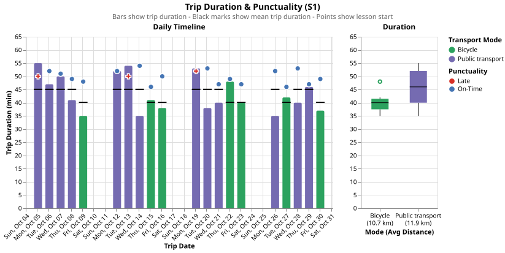
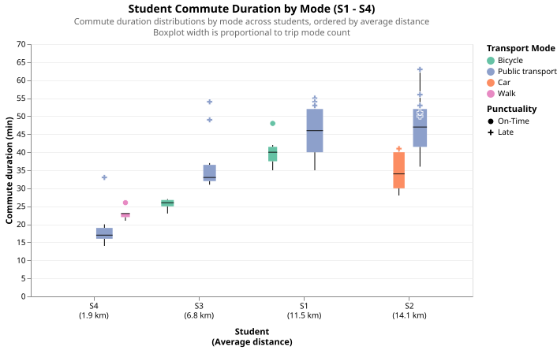
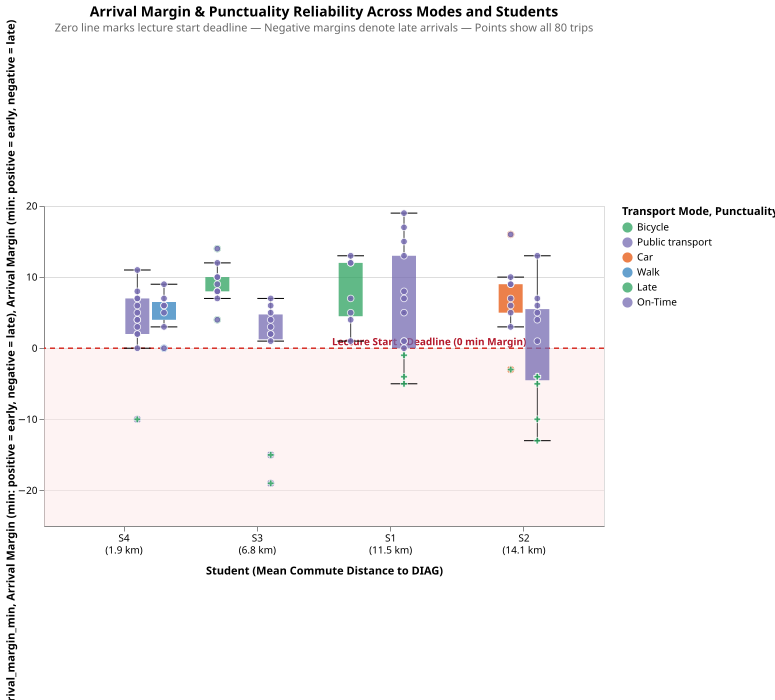
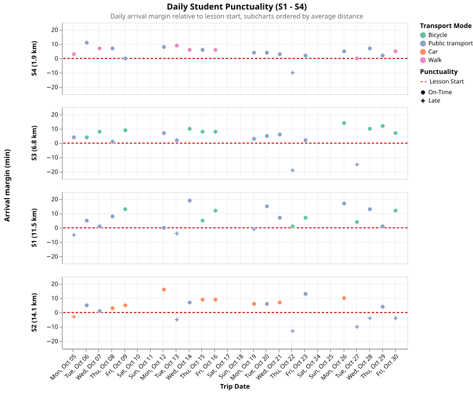
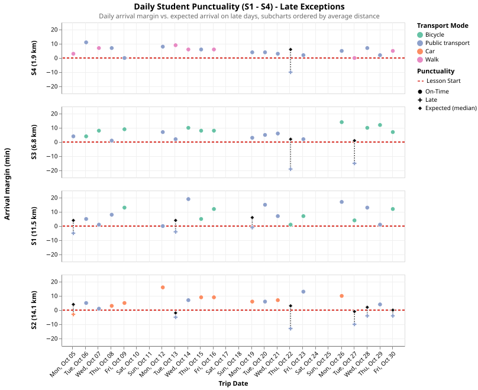

# Getting to DIAG: How much does a journey really cost?

This report explores, both statistically and visually, what it really costs to commute daily to Sapienza's DIAG for lectures. When thinking about "cost", we rarely just mean money. Instead, three distinct dimensions shape the daily commute:

- **Travel time:** door-to-door duration.
- **Monetary cost:** direct expenses per trip.
- **Arrival reliability:** punctuality relative to lecture start.

Data is collected across four students labelled S1 through S4, myself being S1. It spans approximately one month of travel time (October 5 to October 30, 2026) on weekdays, totaling 20 journeys per student and 80 trips overall.

The underlying dataset records seven attributes for every one-way journey:

| Field                | Type         | Description                                                                         |
|:-------------------- |:------------:|:----------------------------------------------------------------------------------- |
| `student_id`         | Categorical  | Student identifier (`S1` for myself; `S2`, `S3`, `S4` for collegues).               |
| `date`               | Temporal     | Date of trip.                                                                       |
| `mode`               | Categorical  | Transport mode chosen (`Bicycle`, `Public transport`, `Car`, `Walk`).               |
| `distance_km`        | Quantitative | One-way distance covered in kilometers.                                             |
| `duration_min`       | Quantitative | Door-to-door trip time in minutes.                                                  |
| `cost_eur`           | Quantitative | Direct out-of-pocket monetary cost in Euro.                                         |
| `arrival_margin_min` | Quantitative | Required arrival time minus actual arrival time (positive = early, late otherwise). |

## 1. Individual Commute Analysis

To begin, let's explore my own commute data as Student S1. Living roughly 11.5 km away from DIAG, I alternate between two modes: I cycle whenever suitable, and take public transport otherwise.

Knowing my routine, I ask myself three questions:

- Bicycling is free, but how much do I actually spend when taking public transit?
- On average, what is the door-to-door duration of both means, and which one gets me to DIAG faster?
- Do I always make it on time? Which mode offers the safest, most reliable commute when there is a strict lecture start deadline?

Table 1 aggregates my 20 journeys by transport modality, transposing metrics into rows for direct comparison.

> **Table 1: Modal Performance Comparison (Student S1)**

| Commute Metric            | Bicycle                                                      | PT                                                           | *Overall (S1)*                                                  |
|:------------------------- |:------------------------------------------------------------:|:------------------------------------------------------------:|:---------------------------------------------------------------:|
| **Trip Count**            | 7                                                            | 13                                                           | *20*                                                            |
| **Average Distance**      | 10.7 km                                                      | 11.9 km                                                      | *11.5 km*                                                       |
| **Average Duration**      | 40.1 min                                                     | 45.1 min                                                     | *43.4 min*                                                      |
| **Median Duration**       | 40.0 min                                                     | 46.0 min                                                     | *41.0 min*                                                      |
| **Duration Spread (IQR)**   | 4.5 min | 12.0 min | *10.5 min* |
| **Total Cost (Avg/Trip)** | €0.00 (€0.00)                                                | €32.24 (€2.48)                                               | *€32.24 (€1.61)*                                                |
| **Late Trips (Rate)**     | 0 (0.0%)                                                     | 3 (23.1%)                                                    | *3 (15.0%)*                                                     |
| **Average Margin**        | +7.7 min                                                     | +5.8 min                                                     | *+6.5 min*                                                      |

Several clear findings emerge from this initial aggregation:

- **Speed:** On average, cycling is faster than public transit: 40.1 minutes by bicycle versus 45.1 minutes by public transport (medians of 40 min vs. 46 min). A 5-minute saving on an 11-kilometer journey might seem modest, and in fact it must be interpreted along the other findings.
- **Predictability:** Cycling times are thinly spread (IQR = 4.5 min), meaning I will know to a certain degree the time I will arrive. Public transit, on the other hand, is more volatile (IQR = 12.0 min, spanning from 35 to 55 minutes). By employing my own nimble vehicle I'm less bounded by external factors, public transit is dependent on them instead. I was never late when cycling, but I have been with public transport (3 times over 13).
- **Behavioral Paradox:** Cycling is better than public transport across all three performance axes: it is faster, completely free, and 100% punctual. Yet, I chose public transport for nearly two-thirds of my commutes. This reveals that the real practical trade-off is independent to speed and money: over an 11 km urban route, physical fatigue and bad weather make paying €2.48 and accepting the risk of being late an acceptable compromise for comfort.

While the summary table captures aggregate statistics, it conceals day-to-day fluctuations. To see how these commutes unfolded across the month, Figure 1 combines two views sharing a common 5-minute vertical scale.

> **Figure 1: Commute Duration Timeline & Modal Variability**

The chart is divided into two purposeful subplots:

- **On the left, the Daily Timeline** displays individual trip data across the month timeline. It compacts four complementary properties into each single day:
  - **Bar height** indicates the door-to-door duration, colored by transport mode (green for Bicycle, purple for Public Transport).
  - **The horizontal black segment** marks the average duration for that specific mode (40.1 min for bike, 45.1 min for transit).
  - **The floating point** represents the time the lecture started relative to when I left home (my planned trip buffer: `duration + arrival margin`).
  - **The vertical gap** between the top of each bar and its floating point indicates my arrival margin. If the point floats above the bar I arrived early (blue circle), if the bar overlaps or exceeds the point I arrived late (red cross).
- **On the right, the Duration Boxplot** offers a side-by-side summary of transport mode variability. The horizontal axis specifies the distance traveled on average by mode (`Bicycle (10.7 km)` vs. `Public transport (11.9 km)`), while the Tukey boxes, black median lines, whiskers, and outlier marks capture the distribution variability.

Two deeper empirical insights stand out from this visualization:

1. **Habitual Consistency in Departure Time:**
   By observing the floating points across the timeline, a behavioral habit becomes apparent: my departure buffer is almost perfectly constant. The points hover horizontally around the 50-minute line. Knowing that my commute takes roughly 40 to 45 minutes on average, I leave home about 50 minutes before lecture start, expecting a 5-to-10 minute buffer regardless of how I travel.

2. **The Anatomy of Transit Delays:**
   Because of this fixed 50-minute departure habit, punctuality hinges entirely on whether the chosen mode can reliably stay under that 50-minute ceiling:

   - When cycling, my travel time remained between 35 and 42 minutes on 6 out of 7 days, leaving plenty of buffer. Even on October 22, when an unusual delay stretched my bicycle ride to 48 minutes (visible as an outlier on the boxplot), the 50-minute buffer still protected me.
   - When taking public transport, however, external factors frequently pushed travel times beyond the 50-minute threshold. Spikes on October 5 (5 min late), October 13 (4 min late), and October 19 (1 min late) clearly exceed the deadline points.

## 2. Group Commute Analysis

Having analyzed my own habits, I now compare my routine with my three classmates. The 80 recorded journeys capture four distinct commuter realities: Student S4 living within walking distance (1.9 km), Student S3 with a short cycle route (6.8 km), myself (S1) at a medium-long distance (11.5 km), and Student S2 facing the longest daily trip across town (14.1 km).

Looking at the four of us, three questions guide this comparative analysis:

- **Distance vs. Time:** Does living further away naturally translate into a linearly longer commute?
- **Modal Economics:** How do monetary expenses compare across students, and what is the real unit cost of commuting?
- **The Anatomy of Delays:** What causes the group's late arrivals? Are they the result of individual scheduling mistakes (leaving home late), or structural breakdowns in Rome's transit network?

Table 2 aggregates student profiles alongside the group benchmark, transposing metrics into rows for direct comparison across the distance gradient. Table 3 similarly breaks down modal efficiency and economics across the four transport options.

> **Table 2: Student Commute Profiles & Group Benchmark**

| Commute Metric | Student S4 | Student S3 | Student S1 (Me) | Student S2 | *Group Benchmark* |
|:---|:---:|:---:|:---:|:---:|:---:|
| **Average Distance** | 1.9 km | 6.8 km | 11.5 km | 14.1 km | *8.6 km* |
| **Modal Split** | PT (13), Walk (7) | Bike (10), PT (10) | Bike (7), PT (13) | Car (9), PT (11) | *PT (47), Bike (17), Car (9), Walk (7)* |
| **Typical Duration** | 19 min | 29 min | 41 min | 41 min | *34 min* |
| **Duration Spread (IQR)** | 7 min | 7 min | 11 min | 14 min | *16 min* |
| **Monthly Cost** | €15.60 | €19.60 | €32.24 | €53.89 | *€121.33* |
| **Late Trips (Rate)** | 1 (5.0%) | 2 (10.0%) | 3 (15.0%) | 6 (30.0%) | *12 (15.0%)* |
| **Average Lead** | 24 min | 35 min | 50 min | 46 min | *38 min* |

> **Table 3: Modal Efficiency & Economics across the Group**

| Commute Metric | Walk | Bicycle | Public Transport | Car | *All Modes* |
|:---|:---:|:---:|:---:|:---:|:---:|
| **Trip Count** | 7 | 17 | 47 | 9 | *80* |
| **Min Distance** | 1.7 km | 6.3 km | 1.9 km | 13.4 km | *1.7 km* |
| **Max Distance** | 1.8 km | 10.8 km | 14.7 km | 13.8 km | *14.7 km* |
| **Door-to-Door Speed** | 4.6 km/h | 15.5 km/h | 13.3 km/h | 24.0 km/h | *15.1 km/h* |
| **Unit Cost** | €0.00 / km | €0.00 / km | €0.20 / km | €0.31 / km | *€0.18 / km* |
| **Late Trips (Rate)** | 0 (0.0%) | 0 (0.0%) | 11 (23.4%) | 1 (11.1%) | *12 (15.0%)* |

Several clear patterns emerge from these tables:

- **The Long-Distance Paradox:** S1 (me) and S2 share the exact same median trip duration (41 min), despite S2 living 2.6 km further away. By driving a private car for 9 trips (which is faster than public transport), S2 offsets the added distance. However, S2 is late twice as often as I am (30% vs. 15%). The reason is a behavioral habit: S2 leaves home with only 46 min of lead time on average, affording barely a 5-minute buffer on a 14.1 km route, whereas my 50-minute habit over 11.5 km gives me a safer margin.
- **The High Cost of Speed:** Driving is the fastest mode (24.0 km/h), but it extracts a heavy financial toll: €0.31/km, raising S2's monthly spend to €53.89 (44% of the entire group's).
- **Public Transit Reliability:** Public transit is the preferred transport mode of the group (47 out of 80 journeys), yet it is the primary cause of tardiness: 23.4% (11) of transit rides result in late arrivals. In contrast, active modes (walking and cycling, 24 trips combined) achieved a perfect 0.0% late rate at zero expense.

To examine how trip duration and dispersion behave across these modalities, Figure 2 plots door-to-door duration distributions across all four students.

> **Figure 2: Student Commute Duration by Mode (S1 - S4)**

The visualization orders students from closest to furthest along the horizontal axis, breaking each student's commute down by transport mode:

- **Tukey boxplots** capture typical durations (the black median line) and dispersion (the interquartile box and whiskers). To convey sample relevance at a glance, the width of each box is dynamically scaled to the number of trips taken with that mode.
- **Colors** distinguish the transport modes: green for Bicycle, purple for Public Transport, orange for Car, and blue for Walk.
- **Overlay marks:** Rather than cluttering the boxes with all 80 points, the chart isolates on-time duration outliers (circles) and trips that ended up late (crosses colored by mode).

Several striking patterns emerge from this duration overview:

1. **Variance Scaling with Route Distance:** For short commutes ($S_4$ at 1.9 km), travel times are tightly bound (IQR of 1 min for walking, 3 min for public transport). As distance increases ($S_1$ and $S_2$), distributions stretch drastically (IQR of 10–12 min), and the tails reach extreme durations.
2. **Short-Distance Waiting ($S_4$):** On a 1.9 km route, walking takes a median of 23 min, while public transport takes 17 min. Transit saves barely 6 minutes, most likely because of waiting times that consume most of the journey. Furthermore, public transport exposes $S_4$ to heavy unreliability (the 33-minute outlier).
3. **Profiling of Late Trips:** the crosses that mark a late arrival always fall on or above the upper whisker. Tardiness, in these cases, can reliably be attributed to traffic or external factors. There is a small exception in $S_2$, but we previously established their delays to thin-margin departures.

While Figure 2 visualizes duration, it does not directly show whether we arrived before the lecture deadline. Figure 3 shifts the focus to our arrival margins.

> **Figure 3: Student Punctuality by Mode (S1 - S4)**

This chart retains the same distance-ordered student and modal layout, but centers the vertical axis on the 0 arrival margin threshold:

- **The red dashed line** marks the Lesson Start deadline at 0 minutes. Positive values indicate early arrival, while negative values represent tardiness.
- **Box widths** remain proportional to trip count, visually emphasizing the statistical weight of each mode.
- **The floating points** highlight outlier early arrivals that don't fit the distributions.
- **The floating crosses** pinpoint all the late arrivals, within or outside the distributions.

This punctuality perspective reveals:

1. **Flawless Reliability of Active Travel:** Walking and cycling always float completely above the red dashed line. Active commuting never experienced a late arrival across the entire month.
2. **$S_2$'s Planning:** Even though we previously said that $S_2$'s tardiness was given by public transport delay, we can clearly notice that they have no problems in arriving in time by car. Given that driving is faster than taking the public transport, perhaps it can be that $S_2$ leaves at the same time for both modalities.
3. **Early Biking:** The two students that bike to class (me and $S_3$) tend to arrive earlier than the rest. We can attribute this to catching some breath and refreshing before the lectures start.

Figures 2 and 3 summarize our entire month, but they collapse the day-to-day timeline. To observe temporal interactions and uncover city-wide events, Figure 4 maps all 80 trips along the 20-weekday timeline.

> **Figure 4: Daily Student Punctuality (S1 - S4)**

The visualization uses four vertically aligned scatterplot sharing identical scales, ordered from nearest to farthest. Comparing our commutes day by day uncovers synchronized significant commute delays.

1. **October 22:**
   - $S_4$ was 10 min late.
   - $S_3$ was 19 min late.
   - $S_2$ was 13 min late.
2. **October 27:**
   - $S_3$ was 15 min late.
   - $S_2$ was 10 min late.

To prove whether we were late because we left home late or because the transport network failed, Figure 5 analyses specifically the 12 late commutes.

> **Figure 5: Late Commute Analysis (S1 - S4)**

This variant compares departure scheduling against actual travel delays across the 12 late trips by using dumbell pairs:

- **The diamond** shows where the student would have arrived under their typical median travel time for that mode—calculated.
- **The solid cross** marks the actual late arrival time.
- **The connecting line** visualizes the unexpected network delay.

By looking at Figure 5, we can conclusively tell that the delays on October 22 and 27 were caused by external problems in the transport infrastructure across the whole city (more than 10 minutes of delay across late students). Then, individually, we can say that:

- $S_4$ and $S_3$ were late only because of public transport issues.
- My ($S_1$) tardiness on some days is caused by slower public transport than expected.
- Only $S_2$ exhibited true late departures from home.
